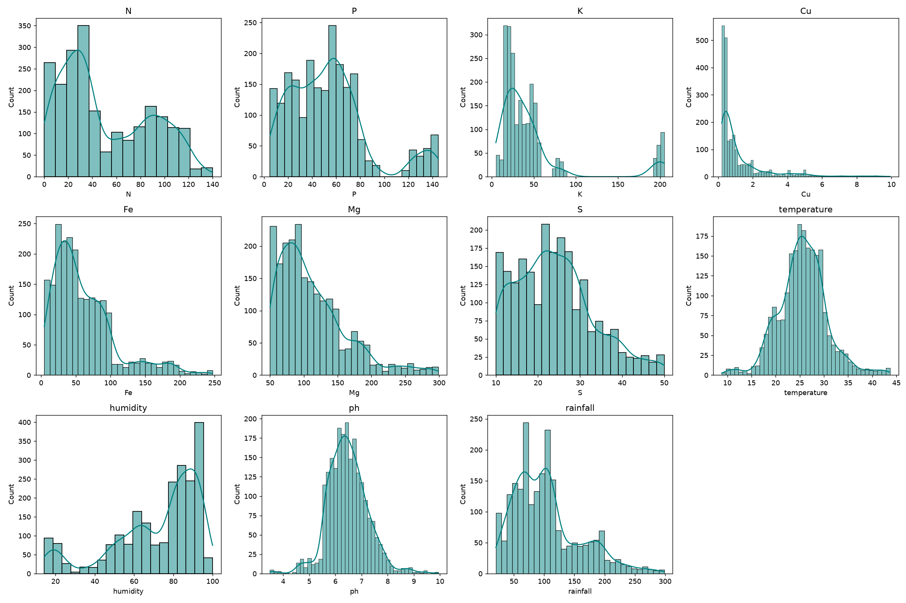
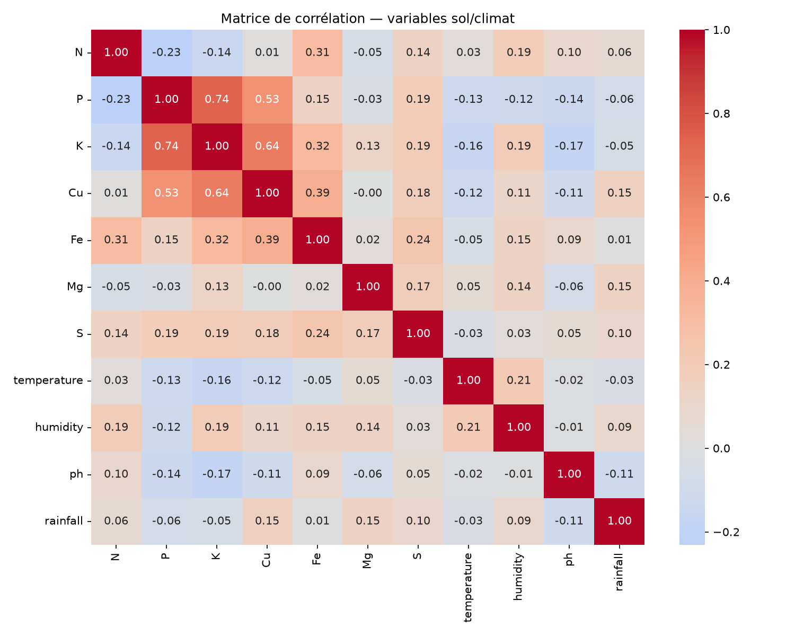
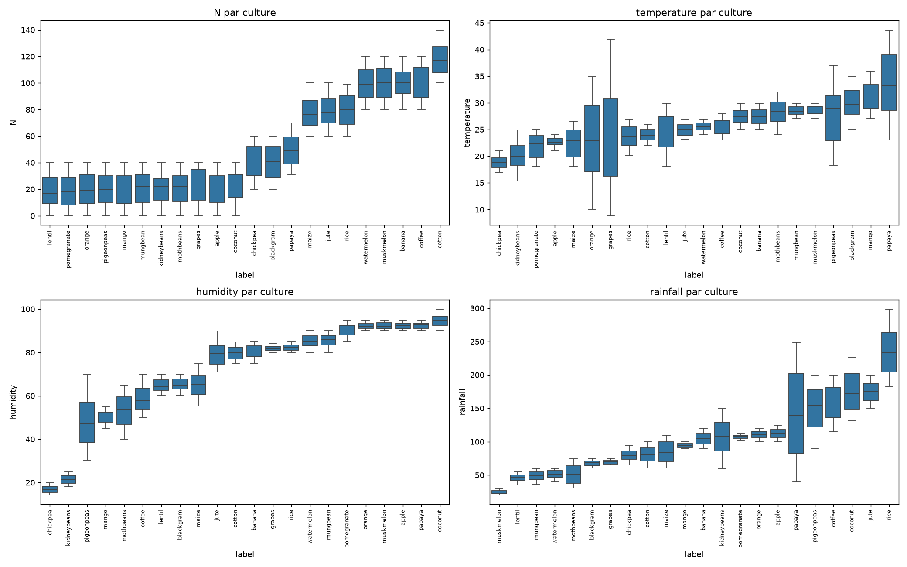
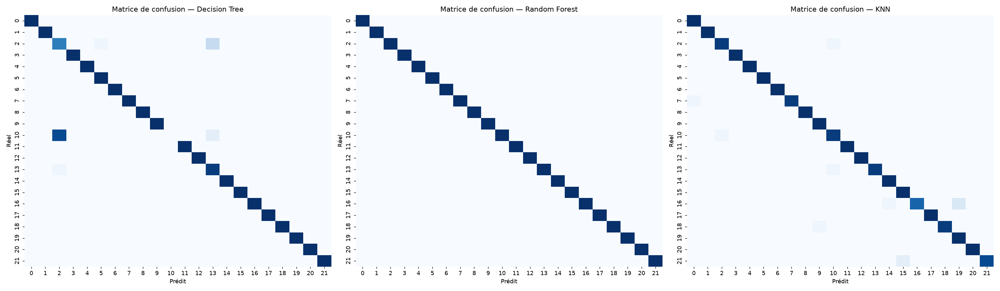
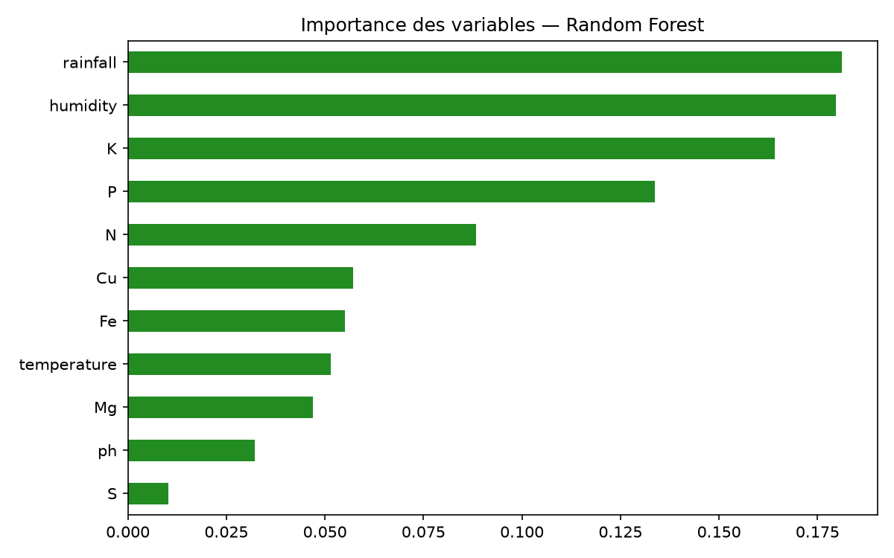
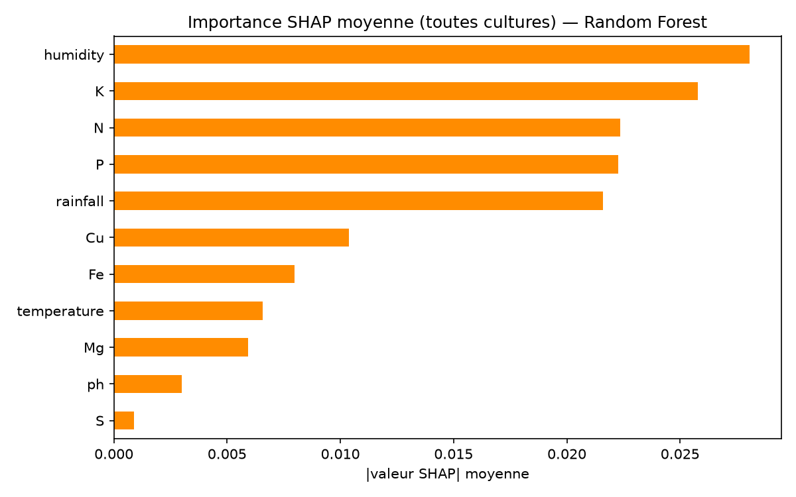

# Machine Learning for Smart Agriculture : prédire la culture la plus adaptée au sol et au climat

*Média Marcel Bakayoko — Expert géomatique / données géospatiales & agricoles / GeoAI / Suivi-Évaluation*

## Le problème

L'agriculture de précision repose sur une question simple en apparence : **quelle culture planter,
compte tenu des caractéristiques du sol et du climat d'une parcelle donnée ?** En pratique, la
réponse dépend de l'interaction de nombreux facteurs — teneur en nutriments du sol (azote,
phosphore, potassium), micronutriments (cuivre, fer, magnésium, soufre), pH, température,
humidité et précipitations — qu'il est difficile d'arbitrer manuellement à grande échelle.

Ce projet explore si un modèle de Machine Learning peut apprendre cette relation à partir de
données historiques et recommander automatiquement la culture la plus adaptée à un environnement
donné.

## Les données

Le **Crop Recommendation Dataset** rassemble 2 200 observations réparties sur 22 cultures
(100 observations par culture) : riz, maïs, coton, café, banane, mangue, raisin, pastèque,
légumineuses (pois chiches, haricots rouges, lentilles...), etc. Onze variables prédictives :
azote (N), phosphore (P), potassium (K), cuivre (Cu), fer (Fe), magnésium (Mg), soufre (S),
température, humidité, pH et précipitations.

Aucune valeur manquante, aucun doublon, classes parfaitement équilibrées (100 observations par
culture) — un jeu de données propre, conçu pour l'apprentissage et la démonstration méthodologique.

**Limite à souligner d'emblée** : ce dataset est dérivé de données agricoles **indiennes**. Les
plages de température, pluviométrie et composition du sol reflètent le contexte climatique et
pédologique de l'Inde. Un modèle entraîné ici ne doit pas être utilisé tel quel pour recommander
des cultures en Côte d'Ivoire ou ailleurs en Afrique de l'Ouest sans réentraînement sur des données
locales — c'est un exercice pédagogique de bout en bout, pas un outil opérationnel régional.

## Exploration des données (EDA)

Les distributions montrent des profils variés : l'azote et le potassium ont une distribution
étalée (0-140 et 5-205 respectivement), les précipitations sont fortement asymétriques à droite
(de 20 mm à près de 300 mm selon les cultures), et le pH se concentre autour de 6,5 (légèrement
acide à neutre), cohérent avec la plupart des cultures vivrières et de rente.

La matrice de corrélation ne révèle pas de colinéarité forte entre les variables prédictives — un
point favorable pour la modélisation, chaque variable apportant une information largement
indépendante.

Les boxplots par culture confirment que chaque culture occupe une niche assez distincte en termes
de besoins en azote, température, humidité et précipitations — par exemple le riz exige une forte
humidité et des précipitations abondantes, tandis que les légumineuses (lentilles, pois chiches)
tolèrent des conditions plus sèches avec des besoins en azote plus faibles (elles fixent elles-mêmes
l'azote atmosphérique).

## Modélisation et comparaison des algorithmes

Trois algorithmes de classification ont été entraînés et comparés sur un split 80/20 stratifié,
avec validation croisée à 5 plis pour écarter tout effet de split favorable :

| Modèle | Accuracy (test) | Precision | Recall | F1-score | CV accuracy (5-fold) |
|---|---|---|---|---|---|
| Decision Tree | 93,9% | 91,4% | 93,9% | 92,4% | 92,6% ± 1,9% |
| **Random Forest** | **100%** | **100%** | **100%** | **100%** | **99,9% ± 0,1%** |
| KNN (k=5) | 97,5% | 97,7% | 97,5% | 97,5% | 96,5% ± 0,7% |

Le Random Forest atteint une **performance parfaite** sur le jeu de test (440 observations, 22
classes), confirmée par une validation croisée à 99,9% — ce n'est donc pas un artefact de split
favorable mais un résultat stable. Cette performance exceptionnelle s'explique par la nature même
du dataset : chaque culture occupe une « niche » assez bien délimitée dans l'espace des variables
sol/climat (confirmé par les boxplots ci-dessus), ce qui rend le problème de classification
particulièrement bien posé pour des méthodes d'ensemble comme Random Forest.

Le Decision Tree seul, plus simple et plus interprétable individuellement, perd en généralisation
(93,9% contre 100%) — l'agrégation de plusieurs arbres (bootstrap + sélection aléatoire de
variables) du Random Forest réduit la variance et améliore nettement la robustesse. Le KNN,
sensible à la mise à l'échelle (appliquée ici via standardisation), obtient un résultat intermédiaire
solide à 97,5%.

## Interprétabilité : quelles variables comptent le plus ?

L'importance des variables du Random Forest classe les précipitations, l'humidité et le potassium
en tête, suivis du phosphore et de l'azote. Les micronutriments (cuivre, fer, magnésium, soufre)
et le pH jouent un rôle secondaire mais non négligeable.

L'analyse SHAP (contribution marginale moyenne de chaque variable aux prédictions, toutes classes
confondues) confirme ce classement avec une méthode indépendante de la Feature Importance native :
**humidité, potassium, azote, phosphore et précipitations** dominent systématiquement. Cette
convergence entre deux méthodes d'interprétabilité différentes renforce la confiance dans le
diagnostic : le climat (humidité, pluviométrie) et la fertilisation (N-P-K) sont les deux familles
de facteurs les plus déterminantes pour le choix de culture, bien plus que les micronutriments
secondaires ou le pH.

## Tableau de bord interactif

Un dashboard Streamlit (`app/dashboard.py`) permet de saisir les 11 paramètres sol/climat via des
curseurs et d'obtenir instantanément la culture recommandée ainsi que le top-3 des cultures les
plus probables avec leurs probabilités. Il intègre un avertissement explicite rappelant l'origine
indienne des données d'entraînement.

Lancement local : `streamlit run app/dashboard.py`

## Limites

1. **Origine géographique des données** : le modèle encode des relations sol-climat-culture propres
   au contexte agro-climatique indien. Son usage pour du conseil agricole en Côte d'Ivoire
   nécessiterait un réentraînement sur des données locales (ex. données ANADER, CNRA, ou stations
   agro-météorologiques ivoiriennes).
2. **Performance « trop parfaite »** : un Random Forest à 100% sur un jeu de test, même confirmé
   par validation croisée, invite à la prudence scientifique — ce résultat reflète la structure
   très séparable du dataset plutôt qu'une garantie de performance sur des données de terrain plus
   bruitées (mesures imprécises, sols hétérogènes à l'échelle de la parcelle, variabilité
   intra-saisonnière).
3. **Absence de variables agronomiques complémentaires** : type de sol (texture, matière organique),
   disponibilité en eau d'irrigation, pratiques culturales antérieures et rotation des cultures ne
   sont pas incluses, alors qu'elles influencent fortement le choix réel d'une culture sur le terrain.
4. **Classes a priori homogènes** : 100 observations par culture, sans déséquilibre — un jeu de
   données réel issu d'enquêtes agricoles présenterait probablement un déséquilibre de classes
   nécessitant un traitement spécifique (sur/sous-échantillonnage, pondération).

## Pistes pour une application au contexte ivoirien

- Remplacer les variables d'entrée par des données locales : analyses de sol ANADER/CNRA, données
  climatiques (stations SODEXAM, produits satellitaires CHIRPS pour la pluviométrie, MODIS/Sentinel
  pour l'humidité du sol).
- Restreindre la liste des cultures candidates aux cultures pertinentes pour le pays (cacao, café,
  hévéa, anacarde, riz, maïs, manioc, igname...) plutôt que les 22 cultures indiennes du dataset.
- Valider le modèle réentraîné par des agronomes de terrain avant tout déploiement opérationnel.

---
*Dataset : Crop Recommendation Dataset, Kaggle (Atharva Ingle) / Mendeley Data, CC BY 4.0.*
